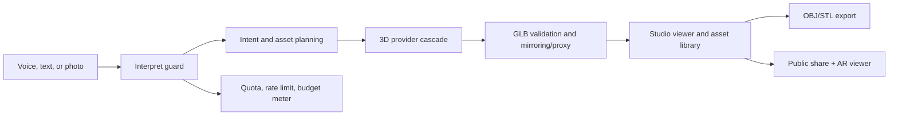

# YIIYA

YIIYA is an AI 3D/CAD asset studio that turns voice prompts and reference photos into validated, shareable 3D assets with export handoffs for creative and technical workflows.

**Live demo:** https://yiiya.vercel.app

## What It Does

- Accepts typed, voice, and reference-image input for fast 3D asset generation.
- Routes generation through a provider cascade instead of depending on one brittle model endpoint.
- Produces GLB previews for the in-browser studio and public viewer.
- Validates and serves generated GLBs through allowlisted hosts and proxy routes.
- Exports real OBJ and STL files from GLB source assets.
- Creates public share links with an orbiting 3D viewer and AR modes through `<model-viewer>`.
- Tracks daily free-generation quota and budget guardrails so expensive provider calls fail closed.
- Keeps setup status visible through production-readiness checks instead of pretending missing credentials are live integrations.

## Why It Is Technically Interesting

Most AI 3D demos stop at "prompt in, mesh out." YIIYA treats generation as a product pipeline:

1. **Intent routing:** voice/text/photo context is normalized into an asset request.
2. **Provider planning:** the app can try multiple 3D providers and fall back when a route is unavailable.
3. **Delivery hardening:** provider URLs are mirrored or proxied so the viewer does not depend on raw expiring model URLs.
4. **Format honesty:** OBJ and STL exports are actual conversions, not renamed GLB downloads.
5. **Public handoff:** a generated asset can become a link, an AR preview, or an export package.
6. **Cost safety:** quota, rate limits, and budget checks run before paid generation work.

That combination makes the project closer to an intent-to-asset compiler than a generic website builder.

## Core Workflows

### Voice/photo -> 3D asset

Users describe an object or attach a reference image. The studio builds an asset request, runs the 3D generation cascade, displays a GLB in the scene, and keeps the interaction loop conversational.

### GLB validation and delivery

Generated GLBs are checked before display. Known provider hosts are allowlisted, Hugging Face-hosted files can be served through `/api/3d/proxy`, and unsafe arbitrary URLs are rejected.

### OBJ/STL export

`/api/3d/convert` fetches an allowed GLB source and converts it into real OBJ or binary STL output. GLB passthrough is also supported. USDZ is intentionally setup-gated until a converter is configured.

### Public share and AR viewer

`/view?src=...&name=...` opens a public 3D viewer backed by Google's `<model-viewer>` component. Visitors can orbit the model in the browser and use supported AR modes on mobile.

### Quota and metering

`/api/interpret/guard.ts` enforces request rate limits, daily generation quota, and per-user/global budget checks before paid AI or 3D provider work runs. Upstash and Supabase make those controls durable in production; in-memory fallbacks protect local/dev sessions.

## Architecture Overview



Key areas:

- `app/app/page.tsx` and `components/yiiya-workspace.tsx`: main studio entry.
- `app/api/interpret/stream/route.ts`: streaming generation route.
- `lib/interpret-pipeline.ts`: provider cascade and generation orchestration.
- `app/api/3d/convert/route.ts`: GLB, OBJ, STL, and setup-gated USDZ export.
- `app/api/3d/proxy/route.ts` and `lib/provider-hosts.ts`: safe model delivery.
- `app/view/page.tsx` and `app/view/viewer.tsx`: public 3D/AR viewer.
- `app/api/interpret/guard.ts`: quota, rate limit, budget, and prompt safety guard.
- `config/production-readiness.json` and `scripts/check-production-readiness.mjs`: deploy readiness checks.

## Tech Stack

- **Frontend:** Next.js App Router, React, TypeScript, Tailwind CSS
- **3D:** Three.js, React Three Fiber, Drei, meshoptimizer, glTF Transform, `@google/model-viewer`
- **AI/providers:** Gemini, OpenAI, Anthropic, Hugging Face Spaces, Tripo, Meshy, Fal
- **Data/storage:** Supabase, Vercel Blob, Upstash Redis
- **Reliability/ops:** Sentry, OpenTelemetry/Langfuse-compatible tracing, production readiness manifest
- **Testing:** Vitest, TypeScript typecheck, targeted route/library tests

## What I Personally Built

- The voice/photo-first 3D asset studio experience and product direction.
- The provider-cascade architecture for 3D generation and fallbacks.
- The GLB delivery hardening, including allowlisted provider URLs and proxy support.
- Real OBJ/STL export conversion for generated assets.
- Public share links and an AR-capable 3D viewer.
- Daily generation quota, metering, and budget guardrails for expensive provider calls.
- Production-readiness checks that make missing credentials visible instead of silently claiming success.
- Agent operating docs, handoffs, and product strategy notes that keep the repo honest and maintainable.

## Screenshots / GIFs

Public media assets are not committed yet. Suggested placeholders before a full public launch:

| Asset | Suggested path | What to capture |
| --- | --- | --- |
| Studio overview | `docs/screenshots/studio-overview.png` | Prompt bar, 3D canvas, asset tray, quota meter |
| Photo-to-3D flow | `docs/screenshots/photo-to-3d.gif` | Reference upload -> generated GLB -> export links |
| Public viewer | `docs/screenshots/public-viewer.png` | `/view` page with orbit controls and AR button |
| Export proof | `docs/screenshots/export-pack.png` | GLB, OBJ, and STL download options |

## Local Setup

Use Node 20.x or 22.x.

```bash
npm install
cp .env.example .env.local
npm run dev
```

Then open http://localhost:3000.

For reliable agent/local verification on machines where the default shell may expose an unsupported Node version, use:

```bash
bash scripts/agent-check.sh npm run typecheck
bash scripts/agent-check.sh npm run test
```

## Environment Variables

`.env.example` documents the available configuration. Keep real values only in `.env.local` or a deployment secret store.

Important notes:

- `.env*.local` is ignored by git.
- Do not commit provider keys, service-role keys, webhook secrets, Sentry auth tokens, Upstash tokens, or Vercel Blob tokens.
- The app can run locally with partial configuration, but production generation, persistence, quotas, scan reconstruction, CAD workers, and telemetry each require their own credentials.
- Run `npm run check:production` before treating a deployment as production-ready.

## Testing

```bash
npm run typecheck
npm run test
npm run check:production
```

Additional commands:

```bash
npm run smoke:scan
npm run build
```

Local notes from this repo's agent playbook:

- `npm run typecheck` and `npm run test` are the preferred local gates.
- `next lint` and local `next build` can hang in some sandboxed shells; use CI/Vercel as the authoritative build gate when that happens.
- Production provider tests can spend credits and should only be run intentionally.

## Production Status and Known Limitations

This repo is public-portfolio ready after a final owner review, but the product is still an active prototype, not a fully finished commercial CAD platform.

Known limitations:

- Raw mesh quality depends on third-party 3D providers.
- Missing provider credentials should be treated as setup-required, not success.
- USDZ/iOS Quick Look export requires a configured converter.
- Scan reconstruction and CAD worker flows require separate worker deployments and credentials.
- Current CAD readiness is a product direction and validation layer; this is not yet a full parametric CAD kernel.
- Some older provider-hosted assets may expire unless mirrored to durable storage.
- Live end-to-end generation can spend provider credits.

## Repository Safety

Before making this repo public:

- Confirm `.env.local` is not tracked.
- Keep `.env.example` placeholder-only.
- Run a tracked-file secret scan.
- Add real screenshots or leave the placeholder table above as honest TODOs.
- Verify the live demo link still reflects the current product story.
