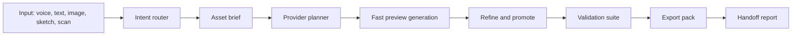

# Yiiya 3D/CAD Product Strategy

Last updated: 2026-06-04

## Product thesis

Yiiya should become a fast intent-to-asset studio for CAD and 3D animation work.
The main user should be able to speak, sketch, upload an image, or scan an
object, then receive a usable 3D asset with clear next steps for Blender, CAD,
3D printing, AR, or animation.

The web builder should be independent and optional. It can remain useful for
portfolios, client presentation pages, and published artifact previews, but it
must not define the main product. The core product is 3D output.

## Target users

- Design students who need to move from concept to model without losing a week
  learning every Blender or CAD setup step.
- Industrial and product designers who need quick concept geometry, variants,
  turntables, and export packs for review.
- CAD users who want natural-language ideation without giving up dimensions,
  parts, constraints, STEP/CadQuery direction, and repairable geometry.
- Illustrators who want to turn sketches, logos, characters, and product art
  into spatial assets while preserving visual identity.
- 3D animators who need fast base meshes, riggable groups, texture passes, and
  Blender/Maya/Unreal handoff.

## Competitor scan

The crowded part of the market is "text/image to mesh." Meshy, Tripo, Hyper3D
Rodin, Autodesk Flow Studio Wonder 3D, Adobe Neo/Turntable, and similar tools
already cover the obvious promise: type words or upload an image, then get a
3D-looking result.

| Tool                           | What it proves                                                                                                                                                                               | Gap Yiiya can attack                                                                                                                                                                |
| ------------------------------ | -------------------------------------------------------------------------------------------------------------------------------------------------------------------------------------------- | ----------------------------------------------------------------------------------------------------------------------------------------------------------------------------------- |
| Meshy                          | Broad mesh exports and API controls: GLB, FBX, OBJ, USDZ, STL, BLEND, 3MF; image-to-3D controls for PBR, remesh, topology, polycount, auto-size, and multi-view thumbnails.                  | Strong output breadth, but still mostly mesh-first. Yiiya should add intent memory, validation, CAD-readiness scoring, and professional handoff decisions.                          |
| Tripo                          | Fast prompt-to-3D, image-to-3D, optional rig/animate/split steps, and exports such as STL/OBJ/FBX.                                                                                           | Great for speed and ideation. Yiiya can beat it with guided refinement, dimensions, part semantics, CAD export planning, and "why this output will or will not survive downstream." |
| Hyper3D Rodin                  | Publicly positions around real-time previews, export to DCC/rendering tools, and manufacturing concerns such as watertight geometry, scale, wall thickness, normals, UVs, and texture scale. | Confirms users care about production readiness. Yiiya should make those checks first-class UI, not buried after export.                                                             |
| Autodesk Flow Studio Wonder 3D | Autodesk is bringing text/image-to-3D, remesh, texture, and downstream pipelines into a mainstream creative suite.                                                                           | Autodesk has distribution, but Yiiyā can be lighter, student-friendly, conversational, and multi-tool rather than locked into a suite.                                              |
| Autodesk Project Bernini       | Research direction validates multimodal 3D shape generation from text, images, sketches, voxels, point clouds, and CAD/object datasets.                                                      | Bernini is experimental. Yiiya can ship practical orchestration now using provider cascades and explicit QA contracts.                                                              |
| Adobe Neo / Turntable          | Adobe is helping 2D creators bridge into 3D while keeping Illustrator/SVG workflows editable.                                                                                                | Yiiya should support illustrators by preserving sketch/vector intent, generating rotations/turntables, and exporting clean grouped geometry.                                        |
| nTop                           | Shows the professional pain: CAD model trees break, parametric design takes expert time, and design logic matters more than a pretty mesh.                                                   | Yiiya should treat intent, constraints, and validation as product primitives.                                                                                                       |

Source links:

- Meshy export formats: https://help.meshy.ai/en/articles/9991884-what-3d-file-formats-do-you-support
- Meshy Image to 3D API controls: https://docs.meshy.ai/en/api/image-to-3d
- Tripo Text to 3D: https://www.tripo3d.ai/features/text-to-3d-model
- Hyper3D Rodin public positioning: https://hyper3d.ai/
- Autodesk Wonder 3D: https://blogs.autodesk.com/media-and-entertainment/2026/03/04/introducing-wonder-3d-text-and-image-to-3d-in-flow-studio/
- Autodesk Project Bernini: https://www.research.autodesk.com/projects/project-bernini/
- Adobe Project Neo: https://www.adobe.com/uk/products/illustrator/2d-to-3d.html
- Adobe Turntable: https://research.adobe.com/news/turntable-and-project-turn-style-a-fresh-spin-on-your-original-art/
- nTop modeling: https://www.ntop.com/software/capabilities/modeling/
- Img2CAD paper: https://arxiv.org/abs/2410.03417
- STEP-LLM paper: https://arxiv.org/abs/2601.12641

## User problems to solve better

1. Meshes are impressive but not editable enough.
   Many AI outputs are visually plausible triangle meshes. CAD users need named
   parts, dimensions, constraints, clean surfaces, and STEP/CadQuery direction.

2. Users do not know which generation path to choose.
   Text, image, multi-image, scan, remesh, texture, rig, and export all have
   different tradeoffs. Yiiya should route automatically and explain the trade.

3. Downstream handoff is too manual.
   Users often have to download, import, repair, resize, retopologize, check
   normals, rebuild materials, and guess export formats. Yiiya should package
   this as a guided handoff.

4. CAD and animation needs diverge.
   CAD wants scale, hard edges, part boundaries, tolerances, STEP/STL, and
   manufacturability. Animation wants topology, UVs, materials, skeletons,
   pivots, groups, FBX/GLB/USD, and motion tests. Yiiya should ask the output
   destination first.

5. 2D creators need respect for their original art.
   Illustrators care about silhouette, style, color, logo fidelity, and editable
   rotations. "Make it 3D" is not enough if the visual identity melts.

## The novel wedge

Yiiya should not simply be another generator. It should be a design compiler
that produces an asset package plus a confidence report.

The differentiator:

- Say or show what you want.
- Yiiya chooses the right route.
- Yiiya creates a preview fast.
- Yiiya lets you refine it with intent, not menu hunting.
- Yiiya validates whether it is usable for CAD, print, animation, AR, or web.
- Yiiya exports the right package and names the remaining risks honestly.

## Core workflows

### 1. Word to 3D asset

Input: "Make a foldable stool with rounded plywood panels and visible hinge
points."

Output:

- Fast preview GLB.
- Final model with grouped parts.
- Turntable render.
- PBR material pass.
- Export pack: GLB, OBJ, FBX, STL, USDZ.
- Future CAD pack: CadQuery script, STEP, dimensions, part tree.
- QA report: scale, manifoldness, topology, texture status, riggability.

### 2. 2D image or sketch to CAD-ready concept

Input: PNG/JPG/SVG/sketch.

Output:

- Silhouette-preserving 3D model.
- Optional line-art/vector interpretation for Illustrator users.
- Named parts and material regions.
- Four cardinal previews.
- "CAD readiness" score with specific repair steps.

### 3. Scan to usable object

Input: phone capture of a real object.

Output:

- Reconstruction job with coverage guidance.
- Cleaned preview mesh.
- Print/animation/web export variants.
- Repair log: missing views, noisy surfaces, thin walls, scale uncertainty.

### 4. Model to motion

Input: finished or generated model.

Output:

- Turntable, exploded view, hinge/pivot preview, or simple rig.
- Export to Blender/FBX/GLB with grouped pivots.
- Motion notes for animation cleanup.

### 5. Optional web presentation

Input: "Make a portfolio page for this chair concept."

Output:

- Independent web page or presentation shell.
- It can embed the model, but it must not be required for the 3D workflow.

## Architecture model

Use a staged pipeline instead of a single "generate" blob.



### Intent router

The router should classify the request by destination, not by UI mode.

- `CAD_CONCEPT`: dimensions, parts, constraints, hard-surface geometry.
- `ANIMATION_ASSET`: topology, UVs, rigging, pivots, FBX/GLB/USD.
- `PRINT_ASSET`: watertightness, wall thickness, STL/3MF, slicer checks.
- `ILLUSTRATION_TO_3D`: silhouette, style, vector/image fidelity.
- `SCAN_RECONSTRUCTION`: capture coverage, reconstruction, cleanup.
- `WEB_PRESENTATION`: optional page/presentation wrapper.

### Asset brief

Every generation should produce a structured brief before expensive work:

```ts
type AssetBrief = {
  sourceKind: "text" | "image" | "multi_image" | "scan" | "svg";
  destination: "cad" | "animation" | "print" | "ar" | "web" | "portfolio";
  objectName: string;
  functionalIntent?: string;
  dimensions?: { unit: "mm" | "cm" | "in"; notes: string };
  partSemantics: string[];
  materialTargets: string[];
  motionTargets: string[];
  exportTargets: Array<
    "glb" | "obj" | "fbx" | "stl" | "3mf" | "usdz" | "step" | "blend"
  >;
  qualityTargets: {
    topology: "preview" | "quad_remesh" | "cad_surface";
    texture: "none" | "pbr" | "style_preserving";
    manufacturable: boolean;
    riggable: boolean;
  };
};
```

### Provider planner

Keep the provider cascade, but make the planner destination-aware.

- Preview: fastest text/image-to-3D provider.
- Final mesh: higher-fidelity image-to-3D or multi-view route.
- Scan: Modal worker, reconstruction, cleanup, UV, packaging.
- CAD future path: generate CadQuery/OpenSCAD/STEP candidates, then validate.
- Repair: meshoptimizer, glTF Transform, manifold/watertight checks, decimation.

### Validation suite

Validation is the product moat. Show it in the UI.

- Format availability: GLB, OBJ, FBX, STL, USDZ, 3MF, BLEND, STEP where possible.
- Geometry: manifold, normals, holes, nonzero volume, wall thickness.
- Topology: triangle count, quad ratio, edge flow notes, riggability.
- Scale: inferred size, unit confidence, origin placement.
- Materials: PBR maps, texture resolution, lighting removal, UV sanity.
- Animation: named groups, pivots, skeleton readiness, motion preview.
- CAD: hard edges, cylinders/planes detection, dimensions, parametric candidate.

### Export pack

Each successful generation should produce an `AssetPack`.

```ts
type AssetPack = {
  id: string;
  brief: AssetBrief;
  previews: {
    poster: string;
    turntable?: string;
    front?: string;
    right?: string;
    back?: string;
    left?: string;
  };
  files: Array<{
    format:
      | "glb"
      | "obj"
      | "fbx"
      | "stl"
      | "3mf"
      | "usdz"
      | "blend"
      | "step"
      | "zip";
    url: string;
    useFor: string;
  }>;
  validation: {
    cadReady: number;
    animationReady: number;
    printReady: number;
    issues: Array<{
      severity: "info" | "warn" | "fail";
      message: string;
      fix?: string;
    }>;
  };
};
```

## Markdown/docs structure

Keep docs aligned with product truth:

- `YIIYA.md`: current runtime state and product north star.
- `docs/PRODUCT_STRATEGY_3D_CAD.md`: this strategy and architecture.
- `docs/PRODUCTION_FOUNDATION.md`: platform, security, telemetry, provider setup.
- `docs/INTEGRATION_GUIDE.md`: implementation wiring.
- `services/reconstruction_worker/README.md`: scan/reconstruction backend truth.
- Future: `docs/ASSET_PACK_CONTRACT.md` for `AssetBrief`, `AssetPack`, validation,
  export naming, storage, and provider output mapping.

## UI changes implied

- Default first screen should be the 3D/CAD workspace.
- Replace "Web + 3D hero compiler" with "CAD + 3D animation studio."
- Rename "3D Hero Lab" to "Model Lab" or "Mold Lab."
- Rename "Publish" to "Export" or "Package."
- Keep "Web" as "Web Brief" or "Presentation" only.
- Show generation route, current output target, and validation status.
- Make the user feel progress: preview in seconds, refinement after, export pack
  at the end.

## Near-term roadmap

### Sprint 1: Reposition and contracts

- Make 3D/CAD the default mode.
- Add `AssetBrief` and `AssetPack` TypeScript contracts.
- Add a generation destination selector: CAD, animation, print, AR, web.
- Make web mode optional in UI copy and routing.

### Sprint 2: Export and validation

- Normalize generated outputs into one export pack.
- Add validation results to the store.
- Show "CAD-ready", "animation-ready", and "print-ready" scores.
- Add GLB/OBJ/FBX/STL/USDZ/3MF export targets where providers support them.

### Sprint 3: Image/sketch to model

- Make reference-image upload ask whether it is for CAD, animation, print, or
  style-preserving illustration.
- Add cardinal-view previews.
- Add material/part segmentation notes.

### Sprint 4: CAD bridge

- Add parametric candidate generation through CadQuery/OpenSCAD.
- Add STEP export experiments.
- Add round-trip notes for Fusion 360, FreeCAD, SolidWorks, Blender, and Maya.

### Sprint 5: Motion handoff

- Add turntable and exploded-view previews.
- Add pivot/group metadata.
- Add Blender-ready export notes and grouped FBX/GLB variants.

## Product promise

Yiiya should make users feel like the boring setup work disappeared, but the
professional control stayed. The product should impress by being fast, honest,
and useful after the first wow moment.
